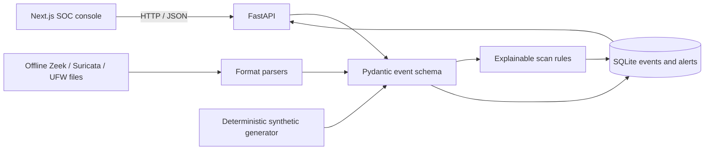

# Port Scan Detection Engineering Lab

An offline-first network telemetry normalization and port-scan detection lab. The checked-in sample logs and deterministic synthetic scenarios are processed locally by a FastAPI API and displayed in a Next.js SOC console. This repository is a developing portfolio project, not a production SOC platform; unsupported features are listed below.

## What Works Today

- Generate labeled synthetic TCP scan or benign-connection events without sending network traffic.
- Normalize IPv4/IPv6 events into a versioned schema and retain their raw input.
- Ingest offline Zeek `conn.log`, Suricata EVE JSON Lines, and supported UFW syslog records. Bad lines are reported without discarding valid neighboring records.
- Store events and explainable alerts in local SQLite; repeated ingestion of the same source file is deduplicated.
- Detect multi-event horizontal port scans, vertical port sweeps, successful TCP connect patterns, low-and-slow multi-port activity, SYN patterns when TCP flags exist, and FIN/NULL/XMAS patterns when the source reports flags.
- View actual stored metrics, events, and alerts in the dashboard; inspect alert evidence and export visible rows to CSV.
- Explore the local REST API through OpenAPI at `/docs`.

Synthetic events are visibly labeled and never sent to the network. The application does not capture live traffic. Optional SIEM delivery, Nmap execution, incidents, report PDFs, authentication, and production deployment are not implemented.

## Architecture



## Requirements

- Python 3.10 or newer.
- Node.js 20 or newer and npm.
- Linux, macOS, or an Ubuntu/Kali virtual machine. External SIEM accounts and root privileges are not required.

## Quick Start

From a terminal at the repository root:

```bash
./install.sh
```

Start the API in terminal 1:

```bash
./run_lab.sh
```

Start the frontend in terminal 2:

```bash
npm run dev
```

Open <http://localhost:3000>. Use **Generate demo events** to create explicitly simulated events. The dashboard refreshes every 15 seconds. Use **Log ingestion** to load an offline file. The API health check is at <http://localhost:8000/health>; interactive API docs are at <http://localhost:8000/docs>.

The API binds to loopback by default. Change `LAB_HOST`, `LAB_PORT`, `LAB_DATABASE_URL`, and `LAB_CORS_ORIGINS` only for a deliberate local deployment. Do not bind to a public interface without adding authentication and deployment hardening.

## Run Tests

```bash
.venv/bin/python -m pytest -q
npm run build
bash -n install.sh run_lab.sh nmap_commands.sh
```

The Python tests cover schema validation, supported sample parsing, malformed lines, deterministic generation, positive scan scenarios, benign negative cases, API persistence, and duplicate ingestion. They do not establish real-world detection accuracy or performance.

## Detection Behavior

The current default threshold is eight distinct TCP destination ports for horizontal scanning, successful connect scanning, or a vertical sweep across eight destinations on one TCP port. SYN detection requires at least that many distinct ports with SYN present and ACK absent. FIN, NULL, and XMAS indicators require at least three matching events across three ports. The low-and-slow heuristic requires eight distinct ports from one source to one destination over at least five minutes. These are configurable in the Python detection function, not yet exposed as operator settings. A single event does not create an alert.

Severity and confidence are simple deterministic heuristics based primarily on observed port count; they are not calibrated risk probabilities. FIN/NULL/XMAS classification is impossible when a sensor omits TCP flags. A Zeek connection summary is not a packet capture and must not be interpreted as proof of individual packet flags. The included UFW parser supports syslog lines containing `SRC`, `DST`, and optional port/protocol fields; it is not a general parser for all firewall products.

## Offline Log Ingestion

The UI accepts UTF-8 files up to 5 MiB. Supported formats:

- Zeek TSV `conn.log` with a `#fields` header.
- Suricata EVE JSON Lines records.
- UFW-style syslog records with source and destination IP fields.

Example with the included fixture: select **Log ingestion**, choose **Zeek conn.log**, select `port_scan_detection_lab/logs/zeek_conn.log`, then choose **Parse and ingest**. The result reports parsed records, accepted events, duplicates, malformed lines, and alerts. No live collection is implied.

## API Endpoints

- `GET /health`: confirms the database can execute a query.
- `GET /api/dashboard/summary`: counts persisted events and alerts.
- `GET /api/events?limit=100&offset=0`: paginated normalized events; optional `source_ip` and `protocol` filters.
- `GET /api/alerts?limit=100&offset=0`: paginated persisted alerts.
- `POST /api/demo/generate?scenario=syn&count=40`: generate local synthetic events (`syn`, `connect`, `sweep`, `fin`, `null`, `xmas`, or `benign`).
- `POST /api/ingest/upload?format=zeek`: multipart upload; `format` may be `zeek`, `suricata`, or `firewall`.

## Repository Map

- `backend/app/`: API, SQLite models, event schema, parsers, generator, and detections.
- `requirements.txt` and `requirements.lock`: supported Python ranges and pinned local environment dependencies.
- `app/`: Next.js dashboard and visual system.
- `tests/`: backend unit and API integration tests.
- `port_scan_detection_lab/`: original sample logs and SIEM reference material; those SIEM artifacts are not connected to a live integration.
- `docs/PROJECT_AUDIT.md`: verified initial repository audit.
- `docs/IMPLEMENTATION_PLAN.md`: phases and verification gates.
- `docs/INSTALLATION.md`: beginner setup, including Windows with an Ubuntu/Kali VM.

## Current Limitations

- No Splunk or Elasticsearch client is implemented; the existing query/dashboard files remain reference examples and are not verified against this API's schema.
- No controlled Nmap runner, sensor process, live packet capture, low-and-slow/distributed detector, or dedicated TCP Connect detector.
- No analyst authentication, alert assignment/status workflow, incident management, audit trail, PDF reports, or detection evaluation metrics.
- No Docker deployment or CI workflow yet. PostgreSQL configuration is not validated.
- Dashboard charts summarize the latest 500 records loaded by the UI. The API summary counts stored events, but filtering, sorting, and server-side time-window queries remain limited.
- Synthetic fixture tests validate implemented behavior, not field performance on production traffic.

See [the installation guide](docs/INSTALLATION.md), [the implementation plan](docs/IMPLEMENTATION_PLAN.md), and [the audit](docs/PROJECT_AUDIT.md) before presenting feature status.