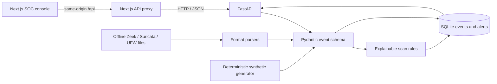

# SentinelSOC — Port Scan Detection Engineering Lab

An offline-first network telemetry normalization and port-scan detection lab. The checked-in sample logs and deterministic synthetic scenarios are processed locally by a FastAPI API and displayed in a Next.js SOC console. This repository is a developing portfolio project, not a production SOC platform; unsupported features are listed below.

## What Works Today

- Generate labeled synthetic TCP scan, low-and-slow, or benign-connection events without sending network traffic.
- Normalize IPv4/IPv6 events into a versioned schema and retain their raw input.
- Ingest offline Zeek `conn.log`, Suricata EVE JSON Lines, and supported UFW syslog records. Bad lines are reported without discarding valid neighboring records.
- Parse authenticated, size- and packet-count-bounded PCAP/PCAPNG uploads into normalized IPv4/IPv6 packet metadata; captures are not replayed and payloads are not stored.
- Store events and explainable alerts in local SQLite; repeated ingestion of the same source file is deduplicated.
- Correlate same-source events across upload batches using a bounded one-hour lookback and merge overlapping alert evidence while retaining analyst status.
- Detect multi-event horizontal port scans, vertical port sweeps, successful TCP connect patterns, low-and-slow multi-port activity, SYN patterns when TCP flags exist, and FIN/NULL/XMAS patterns when the source reports flags.
- View actual stored metrics, events, and alerts in the dashboard; inspect alert evidence and export visible rows to CSV.
- Require authenticated accounts, secure server-side sessions, CSRF protection, and backend-enforced role authorization for API access.
- Manage analyst/viewer accounts and assign alerts/incidents to active analysts; audit entries identify the authenticated account.
- Investigate alerts with persisted event evidence, update alert status/assignment, create incidents, record incident status changes, and export database-backed SOC summary reports.
- Generate authenticated database-backed PDF reports with severity charts, ranked event/alert tables, analyst notes, and selectable reporting periods.
- Explore the local REST API through OpenAPI at `/docs`.

Synthetic events are visibly labeled and never sent to the network. The application does not capture live traffic. Optional SIEM delivery, Nmap execution, live sensors, and production deployment are not implemented.

## Architecture



## Requirements

- Python 3.10 or newer.
- Node.js 20 or newer and npm.
- Linux, macOS, or an Ubuntu/Kali virtual machine. External SIEM accounts and root privileges are not required.

## Quick Start

From a terminal at the repository root:

```bash
./install.sh
```

Start the API in terminal 1:

```bash
./run_lab.sh
```

Before signing in for the first time, create the initial administrator in another terminal. No default credentials are shipped:

```bash
.venv/bin/python -m backend.app.admin create-admin
```

Start the frontend in terminal 2:

```bash
npm run dev
```

Open <http://localhost:3000>. Use **Generate demo events** to create explicitly simulated events. The dashboard refreshes every 15 seconds. Use **Log ingestion** to load an offline file. The API health check is at <http://localhost:8000/health>; interactive API docs are at <http://localhost:8000/docs>.

The API binds to loopback by default and requires an administrator-created account. Keep it loopback-bound unless deployed behind a reviewed HTTPS reverse proxy with `LAB_COOKIE_SECURE=true` and explicit CORS origins.
The development server uses its own `.next-dev` output so a production build does not overwrite its active cache.

### Local Docker Compose

The Compose stack runs PostgreSQL, applies Alembic migrations, and starts the API and frontend. It publishes only the frontend on loopback; the API port is not exposed on the host. Copy `.env.example` to `.env`, replace `POSTGRES_PASSWORD` with a URL-safe random value such as the output of `openssl rand -hex 32`, then run:

```bash
docker compose up --build --wait
docker compose exec api python -m backend.app.admin create-admin
```

Open <http://localhost:3000>. If port 3000 is already occupied, set `FRONTEND_PORT` in `.env` to an available local port before starting. This HTTP setup is for local demonstration only, not production.

### Detection tuning

The local API supports process-start configuration for detection thresholds and source-IP/CIDR allowlisting. For example:

```bash
LAB_DETECTION_THRESHOLD=8 \
LAB_DETECTION_SOURCE_ALLOWLIST="192.0.2.10,2001:db8:1234::/48" \
./run_lab.sh
```

The threshold must be between 3 and 65536. Allowlisted source events are still ingested and shown in event history, but are excluded from scan alert generation. Invalid allowlist entries or thresholds stop API startup with an explicit configuration error. These environment variables do not provide authentication or authorize network access.

## Run Tests

```bash
.venv/bin/python -m pytest -q
npm run lint
npm run typecheck
npm run build
npm run test:e2e
.venv/bin/pip-audit -r requirements.lock
npm audit --omit=dev
bash -n install.sh run_lab.sh nmap_commands.sh
```

The Python tests cover schema validation, supported sample parsing, malformed lines, deterministic generation, positive scan scenarios, benign negative cases, API persistence, and duplicate ingestion. They do not establish real-world detection accuracy or performance.

## Detection Behavior

The current default threshold is eight distinct TCP destination ports for horizontal scanning, successful connect scanning, or a vertical sweep across eight destinations on one TCP port. SYN detection requires at least that many distinct ports with SYN present and ACK absent. FIN, NULL, and XMAS indicators require at least three matching events across three ports. The low-and-slow heuristic requires the configured number of distinct ports from one source to one destination over at least five minutes; the `low_slow` synthetic scenario exercises this behavior. Threshold and source allowlist are configured at API startup using the environment variables above. A single event does not create an alert.

Severity and confidence are simple deterministic heuristics based primarily on observed port count; they are not calibrated risk probabilities. FIN/NULL/XMAS classification is impossible when a sensor omits TCP flags. A Zeek connection summary is not a packet capture and must not be interpreted as proof of individual packet flags. The included UFW parser supports syslog lines containing `SRC`, `DST`, and optional port/protocol fields; it is not a general parser for all firewall products.

## Offline Log Ingestion

The UI accepts UTF-8 files up to 5 MiB. Supported formats:

- Zeek TSV `conn.log` with a `#fields` header.
- Suricata EVE JSON Lines records.
- UFW-style syslog records with source and destination IP fields.

Example with the included fixture: select **Log ingestion**, choose **Zeek conn.log**, select `port_scan_detection_lab/logs/zeek_conn.log`, then choose **Parse and ingest**. The result reports parsed records, accepted events, duplicates, malformed lines, and alerts. No live collection is implied.

## API Endpoints

- `GET /health`: confirms the database can execute a query.
- `GET /api/dashboard/summary`: counts persisted events and alerts.
- `GET /api/events?limit=100&offset=0`: paginated normalized events; optional `source_ip` and `protocol` filters.
- `GET /api/alerts?limit=100&offset=0`: paginated persisted alerts.
- `POST /api/demo/generate?scenario=syn&count=40`: generate local synthetic events (`syn`, `connect`, `sweep`, `fin`, `null`, `xmas`, `low_slow`, or `benign`).
- `POST /api/ingest/upload?format=zeek`: multipart upload; `format` may be `zeek`, `suricata`, or `firewall`.
- `POST /api/ingest/pcap`: multipart offline capture parsing (5 MiB/20,000 packet limit; Ethernet or raw IPv4/IPv6 only).
- `GET/PATCH /api/alerts/{alert_id}`: retrieve evidence and update alert status, severity, assignment, and notes.
- `GET/POST /api/incidents` and `GET/PATCH /api/incidents/{incident_id}`: create incidents from alerts and track their status with audit history.
- `GET /api/reports/summary` and `/api/reports/summary.csv`: generate persisted-record summary reports.
- `GET /api/reports/summary.pdf?period=weekly&download=true`: generate an authenticated PDF report (`daily`, `weekly`, `monthly`, or `all`; `download=false` previews inline).

Database migrations are managed with Alembic. Apply the initial migration with `.venv/bin/alembic upgrade head`; local SQLite also retains its automatic table initialization. The initial migration was tested on SQLite and PostgreSQL 17, and API database health was verified against the temporary PostgreSQL instance; production deployment is still pending.

## Status and limitations

This is an offline-first detection engineering prototype, not a production SOC platform. Features verified in this checkout and the still-pending production work are tracked in [docs/FEATURE_STATUS.md](docs/FEATURE_STATUS.md). PostgreSQL migrations and a loopback-only Docker demo stack are locally verified; remote CI execution and production deployment are pending. Nmap, live packet capture, and SIEM delivery are not implemented. One browser-driven analyst workflow passes, but not all pages or roles have E2E coverage. Keep the API private; the Compose stack publishes only the frontend on loopback. See [docs/SECURITY_REVIEW.md](docs/SECURITY_REVIEW.md) and [docs/DEPLOYMENT_GUIDE.md](docs/DEPLOYMENT_GUIDE.md).

## Repository Map

- `backend/app/`: API, SQLite models, event schema, parsers, generator, and detections.
- `requirements.txt` and `requirements.lock`: supported Python ranges and pinned local environment dependencies.
- `app/`: Next.js dashboard and visual system.
- `tests/`: backend unit and API integration tests.
- `port_scan_detection_lab/`: original sample logs and SIEM reference material; those SIEM artifacts are not connected to a live integration.
- `docs/PROJECT_AUDIT.md`: verified initial repository audit.
- `docs/IMPLEMENTATION_PLAN.md`: phases and verification gates.
- `docs/INSTALLATION.md`: beginner setup, including Windows with an Ubuntu/Kali VM.
- `docs/FEATURE_STATUS.md`, `docs/TESTING_REPORT.md`, and `docs/SECURITY_REVIEW.md`: verified capability, test, and security status.
- `docs/ARCHITECTURE.md`, `docs/USER_GUIDE.md`, and `docs/DEPLOYMENT_GUIDE.md`: current local architecture and operator guidance.

## Current Limitations

- No Splunk or Elasticsearch client is implemented; the existing query/dashboard files remain reference examples and are not verified against this API's schema.
- No controlled Nmap runner, sensor process, live packet capture, distributed or multi-technique correlation, or operator-facing detection UI. Source-IP/CIDR exclusions and threshold are startup environment settings only. The TCP Connect and low-and-slow heuristics remain simple threshold-based rules.
- Authentication, backend role checks, audit identity, bounded ingestion, PDF reports, and one Playwright workflow are covered by local checks; full teams, complete E2E coverage, remote CI execution, and production security validation remain pending.
- PostgreSQL migrations are tested on SQLite and PostgreSQL 17; the local Docker Compose application stack is smoke-tested. Redis/background jobs, container scanning, and production deployment are pending.
- Dashboard charts summarize the latest 500 records loaded by the UI. The API summary counts stored events, but filtering, sorting, and server-side time-window queries remain limited.
- Synthetic fixture tests validate implemented behavior, not field performance on production traffic.

See [the installation guide](docs/INSTALLATION.md), [the implementation plan](docs/IMPLEMENTATION_PLAN.md), and [the audit](docs/PROJECT_AUDIT.md) before presenting feature status.