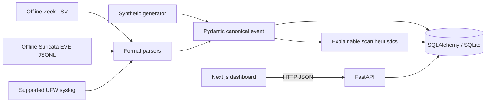

# Architecture

## Current Runtime

The application is a synchronous, local prototype. SQLite tables are created with SQLAlchemy `create_all`; no Alembic migrations or PostgreSQL validation are present.

## Event Flow

1. Demo generation or a bounded UTF-8 upload produces input records.
2. Pydantic normalizes IP addresses, timestamps, protocol names, and available TCP flags; parser records retain the original input.
3. New event IDs are persisted once. Detection considers new events plus same-source history up to one hour before the earliest new event.
4. Detected alert evidence refers to event IDs. Overlapping evidence merges into existing alerts while preserving their status and assignment.
5. The dashboard reads API-backed metrics, events, alerts, and incidents. Refresh is periodic polling, not push streaming.

## Data Model

| Table | Purpose |
|---|---|
| `network_events` | Canonical event columns plus the full normalized event payload. |
| `security_alerts` | Alert status, severity, source, and structured detection/evidence payload. |
| `incidents` | Incident title, description, status, assignment, alert IDs, and resolution. |
| `audit_log` | Local workflow actions with timestamp and structured details; actor is currently a fixed label. |

Foreign-key relationships, normalized user/team/role entities, migration history, retention jobs, and multi-tenant isolation are not implemented.

## Detection Controls

`LAB_DETECTION_THRESHOLD` sets the event/port threshold at API startup (default 8). `LAB_DETECTION_SOURCE_ALLOWLIST` accepts addresses and CIDRs and excludes matching source events from detection only; it does not suppress storage or event visibility. This setting is not a network scan authorization mechanism.

Implemented rules and limitations are tracked in [FEATURE_STATUS.md](./FEATURE_STATUS.md). Current alerts are heuristic and not production-calibrated.

## Target Architecture Not Yet Present

Redis/Celery, PostgreSQL, Alembic, WebSockets/SSE, live sensors, Nmap jobs, PCAP parsing, SIEM clients, authentication/RBAC, PDF generation, Docker, and CI are future work. The platform should remain offline-capable without external services while these are added and verified.
