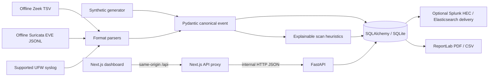

# Architecture

## Current Runtime

The application is a synchronous prototype. SQLite local development continues to create missing tables with SQLAlchemy `create_all`; Docker Compose uses PostgreSQL 17 and runs Alembic before starting the API. PostgreSQL URLs are normalized to the psycopg 3 driver. The local Compose stack was built and smoke-tested; this is not production deployment support. Its API and database share an internal network, while the frontend is the only service published and binds to host loopback. Authenticated report requests aggregate persisted records and generate PDFs in the API process.

When SIEM environment settings are present, newly persisted event batches and generated alert batches are delivered synchronously from the ingest request. Batches are capped at 250 records; successful batch IDs are deduplicated and all outcomes are stored in `integration_deliveries`. Failures do not roll back local event storage. Administrators can retry persisted failed event/alert batches explicitly. A durable background worker, scheduled retries, and delivery backpressure are still needed before larger deployments.

## Event Flow

1. Demo generation or a bounded UTF-8 upload produces input records.
2. Pydantic normalizes IP addresses, timestamps, protocol names, and available TCP flags; parser records retain the original input.
3. New event IDs are persisted once. Detection considers new events plus same-source history up to one hour before the earliest new event.
4. Detected alert evidence refers to event IDs. Overlapping evidence merges into existing alerts while preserving their status and assignment.
5. The dashboard reads API-backed metrics, events, alerts, and incidents. Refresh is periodic polling, not push streaming.

## Data Model

| Table | Purpose |
|---|---|
| `network_events` | Canonical event columns plus the full normalized event payload. |
| `security_alerts` | Alert status, severity, source, and structured detection/evidence payload. |
| `incidents` | Incident title, description, status, assignment, alert IDs, and resolution. |
| `audit_log` | Local workflow actions with timestamp, authenticated actor, and structured details. |
| `users` | Local account identifier, scrypt password hash, role, active state, and creation timestamp. |
| `auth_sessions` | Hashes of opaque session and CSRF tokens, owning user, and expiry. |
| `integration_deliveries` | Batch IDs, remote delivery status/attempt count, safe error summary, and event/alert identifiers. No SIEM credentials or remote response bodies are stored. |

The initial Alembic revision creates these tables and indexes. Foreign-key relationships, normalized team/permission entities, retention jobs, and multi-tenant isolation are not implemented.

## Reports

The authenticated PDF endpoint generates daily, weekly, monthly, or all-time reports from persisted rows. SQL aggregates feed the executive metrics, top-address/port tables, rule/incident distributions, and severity chart. Analyst notes are selected from audit entries. The report states that heuristic/synthetic data is not a real-world efficacy assessment. Report generation runs synchronously and is rate-limited per process; this must be moved to a shared queue/cache for multi-worker use.

## Detection Controls

`LAB_DETECTION_THRESHOLD` sets the event/port threshold at API startup (default 8). `LAB_DETECTION_SOURCE_ALLOWLIST` accepts addresses and CIDRs and excludes matching source events from detection only; it does not suppress storage or event visibility. This setting is not a network scan authorization mechanism.

Implemented rules and limitations are tracked in [FEATURE_STATUS.md](./FEATURE_STATUS.md). Current alerts are heuristic and not production-calibrated.

## Target Architecture Not Yet Present

Redis/Celery, WebSockets/SSE, live sensors, durable/cancellable Nmap jobs, SIEM search/health workflows, and production TLS, backup, monitoring, and scaling controls are future work. A synchronous Nmap API is restricted to explicit private/loopback CIDRs. Offline PCAP parsing, PostgreSQL/Alembic, local Docker Compose, SIEM delivery, and CI configuration exist, but only the scoped checks described in [FEATURE_STATUS.md](./FEATURE_STATUS.md) are verified.
